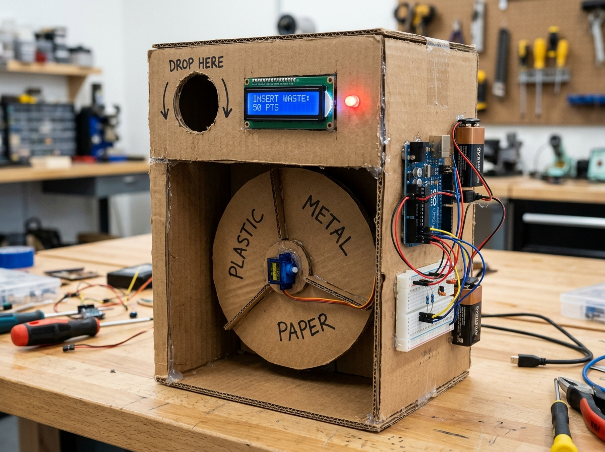
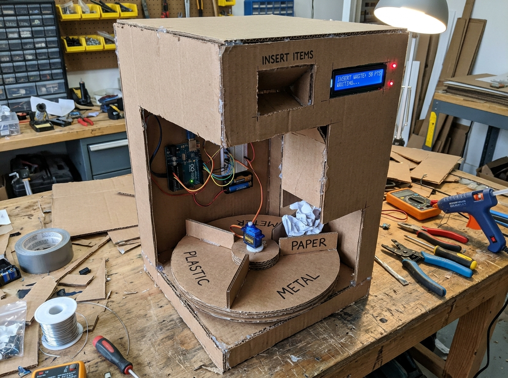

# ♻️ AI-Powered Smart Recycling Vending Machine (RVM)

[](https://www.arduino.cc/)
[](https://flask.palletsprojects.com/)
[](LICENSE)
[]()

An automated, eco-incentivized smart recycling vending machine engineered for rapid, cost-effective waste segregation at source (**Plastic**, **Metal**, and **Paper**). Designed with physical reliability in mind, this project uses an innovative **Single-Servo Rotating Turntable (Carousel) Mechanism** to completely eliminate waste jamming, paired with real-time web telemetry and dual IR feedback.

---

## 📸 Prototype Overview

| Turntable Mechanism (Jam-Free) | Full Prototype Overview |
|:---:|:---:|
|  |  |

---

## 🌟 Key Features

1. **Jam-Free Single-Servo Turntable (Carousel) Architecture:**
   - Instead of narrow, high-friction cardboard sliders where 500ml beverage bottles jam, this machine uses a **horizontal 3-compartment rotating tray** beneath a single vertical drop chute.
   - Powered by **exactly 1 hobby SG90 servo motor**, rotating to discrete indexed angles:
     - **0°**: Plastic Compartment
     - **90°**: Metal Compartment
     - **180°**: Paper Compartment
   - Zero motor strain during item drop — gravity pulls the item straight into the pre-positioned compartment.

2. **Dual IR Detection Pipeline:**
   - **Intake Sensor (D2):** Detects user item insertion at the top opening.
   - **Chute Exit Sensor (D3):** Verifies the item has successfully cleared the drop aperture into the designated compartment.

3. **Dynamic User Feedback:**
   - **16×2 I2C Character LCD (0x27 on A4 SDA / A5 SCL):** Displays real-time instructions, detected waste type, and accumulated reward points.
   - **Status LED (D13):** Visual indicator for active sorting cycles.

4. **IoT & Web Telemetry Dashboard:**
   - **Flask & Chart.js Web App:** Real-time bi-directional serial bridge (`COM11` at 115200 baud).
   - Live analytics for item counts (Plastic, Metal, Paper), reward points, sensor statuses, and manual override testing.

5. **AI Computer Vision Pipeline (ESP32-CAM / OpenCV):**
   - Object detection and classification firmware using ESP32-CAM / webcam stream to identify recyclables before actuation.

---

## 🛠️ Hardware Bill of Materials (BOM)

| Component | Specification | Quantity | Role |
|---|---|:---:|---|
| **Microcontroller** | Arduino Uno R3 (SMD Edition / CH340) | 1 | Master control, sensor polling & servo actuation |
| **Vision Processor** | ESP32-CAM (AI-Thinker OV2640) | 1 | Image capture & AI waste classification |
| **Servo Motor** | TowerPro SG90 Micro Servo (9g) | 1 | Central carousel indexer (0°, 90°, 180°) |
| **Proximity Sensors** | HW-201 IR Obstacle Sensor Modules | 2 | Intake detection (D2) & Chute confirmation (D3) |
| **Display** | 16×2 Character LCD with I2C Backpack (PCF8574) | 1 | User interface & points display |
| **Power Supply** | 5V 2A Regulated SMPS / Adapter | 1 | Dedicated servo & sensor power rail |
| **Prototyping** | 400-Point Solderless Breadboard & Jumpers | 1 | Circuit distribution |
| **Chassis** | Corrugated Cardboard, Hot Glue, Acrylic Pivot | 1 | Physical enclosure & turntable |

---

## ⚡ Circuit & Pin Mapping

```
                                  +-------------------+
                                  | 5V 2A SMPS Power  |
                                  +---------+---------+
                                            | (+5V & GND)
                                            v
+-----------------------+         +---------+---------+         +----------------------+
|    Arduino Uno SMD    | <=====> |  Breadboard Rails | ======> | SG90 Servo (D9 PWM)  |
|                       |  (GND)  +---------+---------+         +----------------------+
| D2  <-----------------+-------------------+ (IR Intake)
| D3  <-----------------+-------------------+ (IR Chute)
| D13 ------------------+-------------------+ (Status LED via 220R)
| A4 (SDA) -------------+-------------------+ (16x2 LCD SDA)
| A5 (SCL) -------------+-------------------+ (16x2 LCD SCL)
+-----------------------+
```

### Detailed Pin Connections

| Arduino Uno Pin | Peripheral | Signal / Pin | Power Rail |
|---|---|---|---|
| **D2 (Digital)** | IR Sensor 1 (Intake) | `OUT` | +5V External Rail, GND |
| **D3 (Digital)** | IR Sensor 2 (Chute Exit) | `OUT` | +5V External Rail, GND |
| **D9 (PWM)** | SG90 Micro Servo | `Signal (Orange/Yellow)` | +5V External Rail, GND |
| **D13 (Digital)** | Status Red LED | `Anode (+)` via 220Ω | GND |
| **A4 (SDA)** | 16×2 LCD I2C Module | `SDA` | +5V External Rail, GND |
| **A5 (SCL)** | 16×2 LCD I2C Module | `SCL` | +5V External Rail, GND |
| **GND** | Breadboard Ground Rail | Common Ground | **Critical: Tie Arduino GND to SMPS GND** |

> ⚠️ **Crucial Electrical Rule:** Always tie the Arduino `GND` to the external 5V 2A SMPS `GND`. Never draw SG90 servo stall current (~500mA–800mA) directly through the Arduino's 5V voltage regulator pin, or the board will freeze/reset during motor movements.

---

## 📂 Project Repository Structure

```
recyling-wending-machine-/
├── app.py                                   # Flask Real-Time Web Telemetry Dashboard
├── start_dashboard.bat                      # 1-Click Windows Launcher for Web App
├── requirements.txt                         # Python dependencies
├── master_vending_machine_arduino/
│   └── master_vending_machine_arduino.ino   # Core Arduino Uno controller firmware
├── esp32_cam_ai_classifier/
│   └── esp32_cam_ai_classifier.ino          # ESP32-CAM AI vision classification sketch
├── docs/
│   └── images/                              # High-resolution prototype diagrams & renders
├── LICENSE                                  # MIT Open Source License
└── README.md                                # Comprehensive documentation
```

---

## 🚀 Quick Start Guide

### 1. Arduino Firmware Upload
1. Connect your Arduino Uno SMD to your computer (e.g. `COM11`).
2. Open `master_vending_machine_arduino/master_vending_machine_arduino.ino` in Arduino IDE.
3. Install required libraries:
   - `LiquidCrystal I2C` (by Frank de Brabander)
   - `Servo` (built-in AVR)
4. Select board **Arduino Uno** and your designated COM port, then click **Upload**.

### 2. Launching the Web Dashboard
1. Ensure Python 3.8+ is installed.
2. Install Python dependencies:
   ```bash
   pip install -r requirements.txt
   ```
3. Run the dashboard:
   ```bash
   python app.py
   # Or simply double-click start_dashboard.bat
   ```
4. Open your browser and navigate to `http://localhost:5000`.

---

## ⚙️ How the Carousel Mechanism Works

```
        [ Drop Chute (Top Opening) ]
                     │
                     ▼ (Straight Vertical Drop - No Jamming!)
    +------------------------------------+
    |         Rotating Turntable         |
    |  [PLASTIC (0°)]    [METAL (90°)]   |
    |          [PAPER (180°)]            |
    +-----------------+------------------+
                      │
               [ SG90 Servo ]
            (Mounted Vertically)
```

1. **Standby State:** The turntable rests at default (0° - Plastic). LCD displays `"INSERT ITEM"`.
2. **Detection & AI Classification:** IR Intake sensor detects an inserted item. The classifier identifies the waste type.
3. **Tray Indexing:** The SG90 servo indexes the turntable:
   - If **Plastic** ➔ Servo moves to **0°**
   - If **Metal** ➔ Servo rotates to **90°**
   - If **Paper** ➔ Servo rotates to **180°**
4. **Deposit & Verification:** The item drops directly into the aligned compartment. The lower chute IR sensor confirms passage.
5. **Reward & Logging:** Points are credited, the LCD flashes confirmation, and telemetry is updated on the Flask dashboard.

---

## 🔧 Engineering Insights & Lessons Learned

- **Breadboard Split Rails:** Many 400-point breadboards have disconnected center power rails. Always run short jumper wires bridging the top and bottom rails to guarantee ground continuity.
- **Micro-Servo Stall Prevention:** An SG90 micro-servo has ~1.6 kg·cm of torque. Slanted flaps bearing the weight of a heavy can will stall the servo. The **Turntable Carousel** design circumvents this by pre-positioning the bin *before* the item drops, removing all vertical load from the servo.
- **I2C Address Discovery:** Ensure your LCD module is verified at address `0x27` (or `0x3F`) with an I2C scanner sketch if the display powers on but shows no text.

---

## 👥 Contributors & Academic Context

- **Author / Developer:** Anurag Kumar ([@kumaranurag7278-lgtm](https://github.com/kumaranurag7278-lgtm))
- **Project:** Engineering Clinic Project
- **Institution:** Chandigarh Group of Colleges (CGC) University, Mohali

---

## 📄 License

This project is open-source under the [MIT License](LICENSE). Feel free to use, modify, and build upon this design for academic and personal projects!
